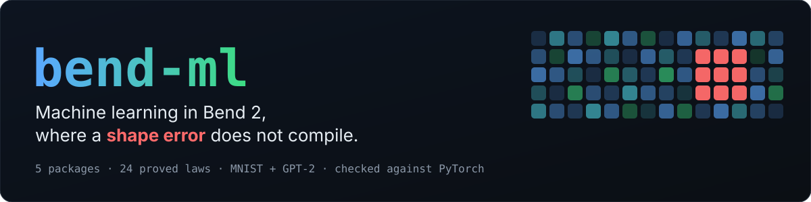
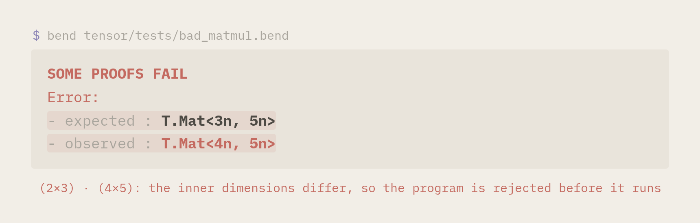
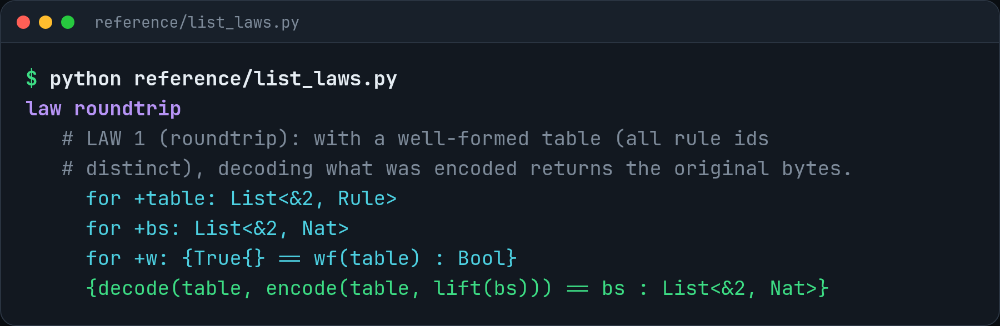
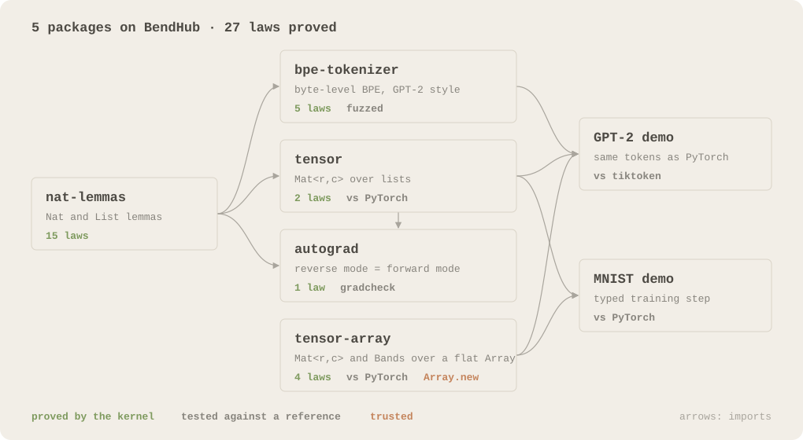
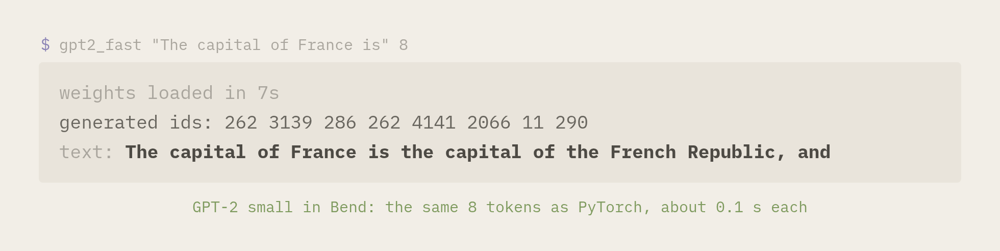
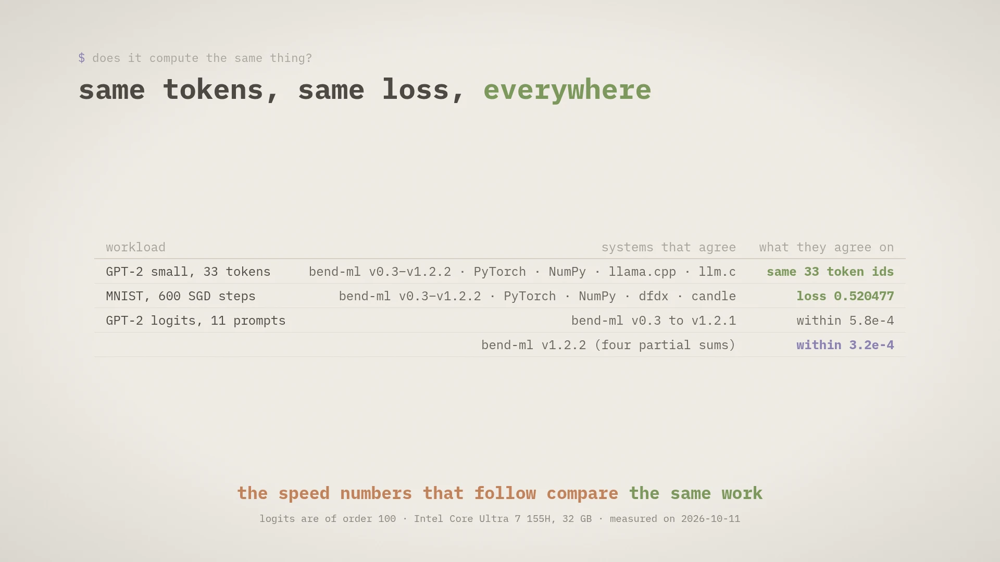
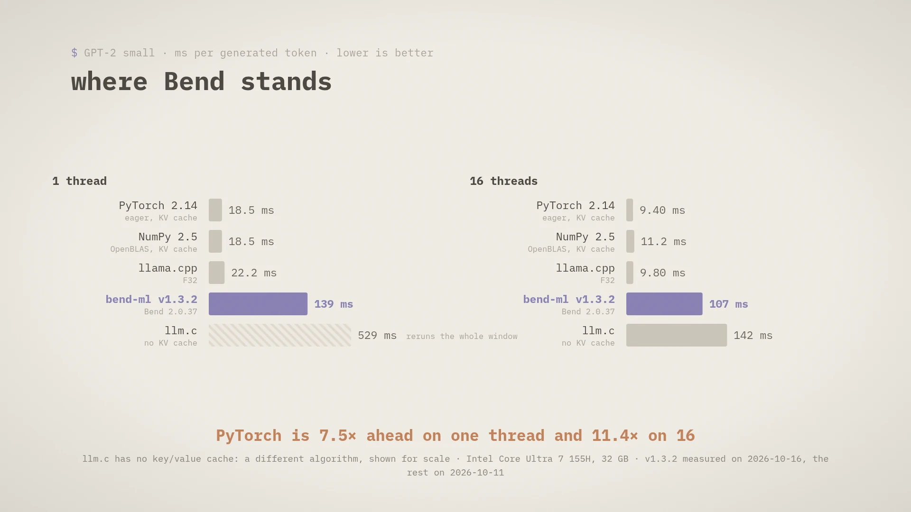
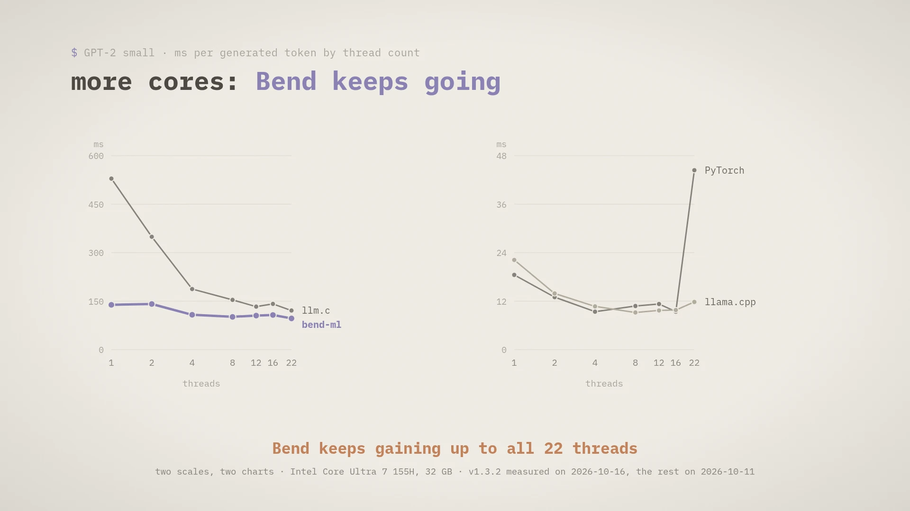
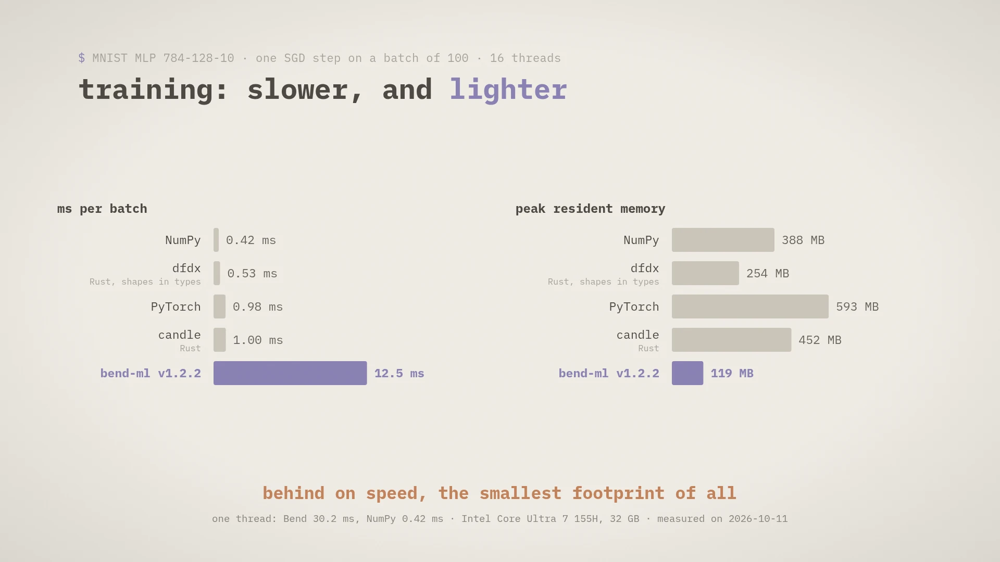
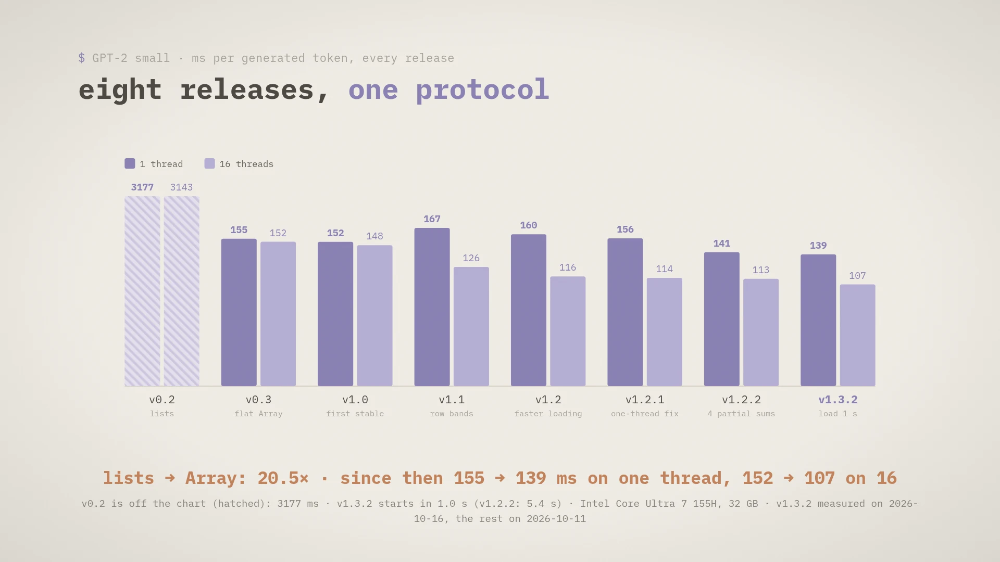

<p align="center">
  
</p>

<p align="center">
  <a href="https://github.com/nuxyel/bend-ml/actions/workflows/ci.yml"></a>
  <a href="LICENSE"></a>
  <a href="https://bend-lang.com"></a>
  
</p>

**bend-ml** is machine learning for [Bend 2](https://bend-lang.com). The shape of every tensor lives in its type, so a
product of mismatched matrices does not compile, and the structural guarantees (a tokenizer that never loses a byte, a
reverse mode that agrees with the forward mode, a parallel product that covers every row) are laws that Bend's kernel
checks. Six packages are on BendHub, and two demos run on them: an MNIST classifier that trains, and GPT-2 small, which
generates the same tokens as PyTorch. The current release is [v1.3.2](https://github.com/nuxyel/bend-ml/releases/tag/v1.3.2).

## 01 · A shape error is a type error

<p align="center"></p>

```python
# (2x3) · (4x5): does not compile
def bad() -> TA.MMul<2n, 3n, 5n>:
  TA.Mat.matmul(2n, 3n, 5n, 0n, TA.Mat.zeros(2n, 3n), TA.Mat.zeros(4n, 5n))
```

The sizes do not have to be constants. A batch size read from a file is checked once where the data enters, and every
layer after it is checked for any batch size ([`examples/runtime_batch.bend`](examples/runtime_batch.bend)). A `reshape`
only compiles with a proof that the number of elements does not change, even when the sizes are only known at run time
([`examples/symbolic_reshape.bend`](examples/symbolic_reshape.bend)).

## 02 · Laws, not trust

| Package | Version | What it is | Proved laws |
|---|---|---|---|
| [`bend-ml-nat-lemmas`](nat-lemmas) | 0.1.1.0 | `Nat` and `List` lemmas that Base does not have | `add_comm`, `add_assoc`, `mul_comm`, `mul_assoc`, `mul_dist`, `append_assoc`, `length_append`, `product_append`... (15) |
| [`bend-ml-bpe-tokenizer`](bpe) | 0.1.3.0 | Byte-level BPE tokenizer (GPT-2 style) | **roundtrip** `decode(encode(s)) = s`, `vocab_bound`, `dec_append`, `train_wf`, `roundtrip_trained` |
| [`bend-ml-tensor`](tensor) | 0.1.2.0 | `Vec<n>` and `Mat<r,c>` with the shape in the type, over lists | `reshape_swap`, `reshape_flat` |
| [`bend-ml-tensor-array`](tensor-array) | 0.1.11.0 | the same guarantees over a flat `Array<F32>`; `Bands<r,c>` for a parallel matrix · vector | `cap_ok`, `half_cover`, `leaf_len`, `band_len`; typed `matmul`, `matmul_nt`, `matmul_tn` (and their accumulating forms), `Bands.matvec` |
| [`bend-ml-autograd`](autograd) | 0.1.1.0 | Automatic differentiation and layers with typed backward | **`reverse_eq_forward`** |
| [`bend-ml-binary-read`](binary-read) | 0.1.0.0 | F32 weights read from a file straight into an `Array<F32>`; foreign code (C and JavaScript), kept out of the packages with laws | none: an effect, tested on both lanes |

```python
import bend-ml-tensor-array@0.1.11.0/main.bend as TA
import bend-ml-bpe-tokenizer@0.1.3.0/main.bend as BPE
```

<p align="center"></p>

<p align="center"></p>

Every package with laws passes `bend X/main.bend --verdict`, the re-check by Bend's Lean-proved kernel, with no `@unsafe`
and no `?TODO`. `bend-ml-binary-read` is the exception by design: it is a file read written in C and JavaScript, one
definition, and no package with laws imports it (`make check` checks both).

Numbers are a different matter: `F32` is not a real number, so the numerics are tested against PyTorch, NumPy and
`tiktoken` instead of proved. [`docs/AUDIT.md`](docs/AUDIT.md) lists the trust base.

## 03 · It runs, and it computes the same thing

<p align="center"></p>

| Demo | What it does | Checked against |
|---|---|---|
| [GPT-2 small](demos/gpt2), 124 M | greedy generation with a key/value cache, the weights in parallel row bands, loaded in 0.8 s | PyTorch on 11 prompts: the same tokens, logits within 3.2e-4; the tokenizer matches `tiktoken` on 79 texts |
| [MNIST](demos/mnist), 784-128-10 MLP | SGD training with every shape typed | PyTorch with the same initial weights and batches: the same loss and hits |

Built on bend-ml: [llama.bend](https://github.com/nuxyel/llama.bend) runs SmolLM2-135M, 360M and 1.7B in Bend with the
same tokens as `transformers`; its typed layers are on BendHub as `bend-ml-llama`. Since its v1.1.0 the 1.7B starts in
9 s instead of 72, with bend-ml's `binary-read` and `bpe-tokenizer` 0.1.3.0.

<p align="center"></p>

## 04 · How it compares

Every release up to v1.2.2 was measured on 2026-10-11 next to six reference systems, in one session with one protocol
(medians of alternated rounds on an Intel Core Ultra 7 155H). v1.3.2 was measured on 2026-10-16 with the same protocol,
next to v1.2.2, PyTorch and NumPy again, which came out within 2% of their numbers of 2026-10-11; llama.cpp, llm.c,
dfdx and candle keep theirs. GPT-2's cost per token is unchanged since v1.2.2 (139 ms on one thread, 107 on 16); what
changed is the start (1.0 s instead of 5.4, at 831 MB instead of 1,464 MB) and training: an MNIST batch takes 20.0 ms
instead of 29.9 on one thread, 7.7 instead of 12.8 on 16.

<p align="center"></p>

<p align="center"></p>

<p align="center"></p>

## 05 · Every release

<p align="center"></p>

Since v1.2.2, each change keeps the output bits it had (checked word by word, or against PyTorch where the order of
sums changed on purpose):

| Release | What changed | Measured |
|---|---|---|
| v1.2.4 | Bend 2.0.37, with my fix for parallel code with an erased last parameter ([#1377](https://github.com/bendlang/bend/pull/1377)) | GPT-2 per token unchanged; the compiled program half the size |
| v1.2.5 / v1.2.6 | `tensor-array` 0.1.8.0 and 0.1.9.0: products in cells of 8 numbers, parallel without per-block copies | a matrix product ~3x faster on one core |
| v1.3.0 | `tensor-array` 0.1.10.0: accumulating products (`C + A·B` in place) and array capacities computed by doubling; the new `bend-ml-binary-read` | a weight gradient 0.44–0.88 of the time; GPT-2's weights load in 0.8 s instead of 4.7 |
| v1.3.1 | `bpe-tokenizer` 0.1.3.0 and `tensor-array` 0.1.11.0: an accumulator only the proofs read is erased; products split into parallel blocks only when the work pays | tokenizing 2x faster (19 KB: 25.2 → 12.3 s); a weight gradient over 8 tokens 3.3x faster on 16 threads |
| v1.3.2 | the MNIST demo moves from `tensor-array` 0.1.3.0 to 0.1.11.0; the README and its figures measured again | an MNIST epoch 17.9 → 11.9 s on one thread, 7.3 → 4.4 s on 16, the same test hits |

Versions are numbered as in [`docs/VERSIONING.md`](docs/VERSIONING.md); each release has its notes on GitHub.

## 06 · Reproduce

Linux x86_64 (or WSL), clang ≥ 14, Python ≥ 3.12, `curl`, ~3 GB of disk, 8 GB of RAM for the GPT-2 check.

```bash
git clone https://github.com/nuxyel/bend-ml.git && cd bend-ml
make setup          # Bend 2.0.37 (SHA256-checked), Lean 4.34.0, Python venv, data; no sudo
make check          # 53 checks, about 2.5 min
make check-full     # 61 checks with GPT-2 and MNIST, about 5 min
make media          # regenerate the figures on this page (needs node, ffmpeg, Brave)
```

`make setup-lite` skips the 550 MB GPT-2 download. CI runs `make check-full` on every push. `main` holds the released
versions; work in progress lives on `devel`.
Contributions are welcome: see [`CONTRIBUTING.md`](CONTRIBUTING.md) (pull requests go to `devel`).

## Upstream

What this project found in Bend and reported:

- [#1374](https://github.com/bendlang/bend/issues/1374): an erased last parameter made a parallel let sequential. Fixed by my PR [#1377](https://github.com/bendlang/bend/pull/1377), released in Bend 2.0.37.
- [#1375](https://github.com/bendlang/bend/issues/1375): `IO.fork` does not spread pure work over cores. The guide now says so ([#1415](https://github.com/bendlang/bend/pull/1415)).
- [#1376](https://github.com/bendlang/bend/issues/1376): a read-only borrow of an `Array` for a parallel let, without `@unsafe`. Open.
- [#1573](https://github.com/bendlang/bend/issues/1573): a file read into an array instead of a list with one cell per byte. Open; `bend-ml-binary-read` is the library workaround until then.

<p align="center"><sub>MIT · the visual identity uses Bend's own colours, from bend-lang.com · the launch video (v1.0): <a href="https://github.com/nuxyel/bend-ml/releases/download/v1.0.0/bend-ml.mp4">bend-ml.mp4</a></sub></p>
